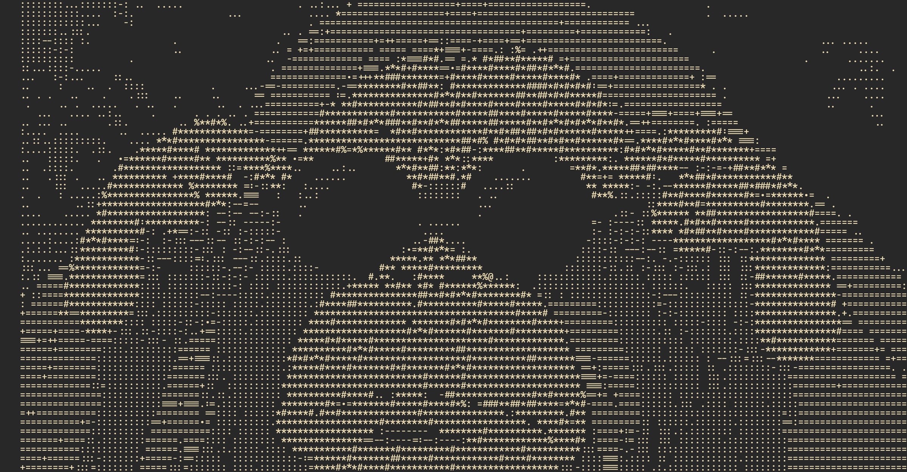

# orangui

The Dioxus UI kit behind my apps and sites. The name is orangutan, a call sign of mine, plus GUI.

It runs in:

- [zwipe](https://github.com/scadoshi/zwipe), the app and zwipe.net
- [cairn](https://github.com/scadoshi/cairn), a counter app
- [portfolio](https://github.com/scadoshi/portfolio), where the [orangui page](https://scottyfermo.com/projects/orangui/) shows every piece live

## Use

```toml
[dependencies]
orangui = { git = "https://github.com/scadoshi/orangui" }
```

Turn on `features = ["toast"]` if you want toasts. Then inline the stylesheets in this order:

1. `THEMES_CSS`
2. `COMPONENTS_CSS`
3. `APP_CSS` for an app, `SITE_CSS` for a site

Your own sheet can load before or after them. The rules the kit sticks to, and the tests that check them, are in [context/](context/).
